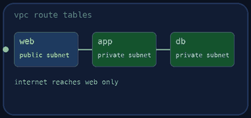
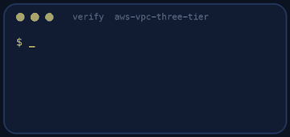
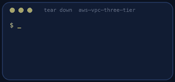

<p align="center"></p>

| | |
|-|-|
| **Time** | 90-105 min |
| **Cost** | free (the NAT Gateway is optional and you delete it the same day) |
| **You need** | An AWS administrator user (the IAM lab), the AWS CLI v2 configured for it, Python 3 and a terminal |

## How this lab works

1. **Fork** this repository to your own GitHub account (button at the top right).
2. Clone **your fork** in your Ubuntu environment (WSL on Windows, your OrbStack machine on Mac).
3. Read the lab below (the same text is in [`LAB.md`](LAB.md)) and follow the mission.
4. Answer the questions in [`SUBMISSION.md`](SUBMISSION.md). Where a question asks for output, paste it in a code block. No screenshots needed.
5. Commit and push. Open the **Actions** tab of your fork (click *I understand my workflows, go ahead and enable them* the first time). The **Lab check** shows what is still missing.
6. When the check is green, **submit the URL of your fork** in the course platform.

> [!NOTE]
> The check only looks at your answers and any files the lab asks you to commit. Your instructor reads your work and may ask you to explain any line.

<p align="center"></p>

## 🎬 The situation

<p align="center"></p>

On Monday an external auditor reviews the Clippy network. You have read the checklist and it is short and strict:

1. The **web tier** may be public.
2. The **app tier** may reach the internet (to download updates) **only through a NAT**, and nothing on the internet may initiate a connection to it.
3. The **data tier** must have **no route to the internet in either direction**, and must accept PostgreSQL **from the app tier and from nothing else**: at two independent layers, so that one mistake does not open the door.
4. Everything must survive the loss of one availability zone: two of each tier.

You will design the address plan, build the whole VPC in the console (once, slowly, to understand every object), and then check it the way the auditor will. There are no servers in this lab: a network is a set of rules, and the rules are what gets audited.

> [!IMPORTANT]
> **Your mission**
> - Plan the CIDR blocks on paper first
> - Build the VPC, six subnets, route tables, an internet gateway and a NAT Gateway
> - Build one security group per tier, each trusting only the tier in front of it
> - Build a network ACL that locks the data subnets a second time
> - Prove every claim the auditor will test, then tear it all down (a NAT Gateway bills every hour)

**Time:** 90-105 min | **Cost:** free (the NAT Gateway costs about five cents an hour; delete it the same day) | **You need:** an AWS administrator user, the AWS CLI v2 configured for it, Python 3 and a terminal.

<p align="center"></p>

## Part 0 - The plan, on paper

Before you click anything write this down in `notes.md` (it is the first thing a reviewer asks for):

- The VPC range: a `/16` from private space. Choose one that does not collide with a network you might peer with later (the staging VPCs of the other labs use `10.1.0.0/16` and `10.2.0.0/16`).
- Six subnets, **two per tier, in two availability zones**, each `/24`. Name them `web-a`, `web-b`, `app-a`, `app-b`, `data-a`, `data-b`, and tag each with `Tier = web`, `Tier = app` or `Tier = data`.
- Which subnets are public. How many usable addresses does AWS give you in a `/24`? (It is not 256.)

> [!NOTE]
> **Think** Why `/24` for three tiers when the VPC is a `/16`? What would you regret in two years if each subnet were a `/28`?

<p align="center"></p>

## Part 1 - Build the VPC

In the console (VPC → *Create VPC* → *VPC only*) and then each piece separately, so you see every object. Tag **everything** with `lab = aws-vpc-three-tier`.

1. The VPC and an **internet gateway** attached to it.
2. The six subnets. Turn on **auto-assign public IPv4** on the **web** subnets only.
3. An **Elastic IP** and a **NAT Gateway** in a **web** subnet (a NAT Gateway must live in a public subnet).
4. Three **route tables**, one per tier:

| Route table | Associated with | Default route (`0.0.0.0/0`) |
|-------------|-----------------|------------------------------|
| web | both web subnets | internet gateway |
| app | both app subnets | NAT Gateway |
| data | both data subnets | **none** (only the automatic `local` route) |

> [!NOTE]
> **Think** The data route table has no route to `0.0.0.0/0`. A database in it cannot download an update. How do you patch it anyway? (Think: VPC endpoints, a bastion, a managed service.)

<p align="center"></p>

## Part 2 - One security group per tier

Create `clippy-web`, `clippy-app` and `clippy-data` in the VPC, tagged `lab = aws-vpc-three-tier`:

| Group | Inbound |
|-------|---------|
| `clippy-web` | TCP 80 and 443 from `0.0.0.0/0` |
| `clippy-app` | TCP 8000 **from the group `clippy-web`** |
| `clippy-data` | TCP 5432 **from the group `clippy-app`** |

> [!NOTE]
> **Think** Security groups are *stateful*: you never write a rule for the reply. Say in your own words what that means for the data group, and why there is no inbound rule for the web tier anywhere in it.

<p align="center"></p>

## Part 3 - The second lock: a network ACL

A network ACL works on the whole **subnet**, is **stateless** and is checked before the security group. Create a custom ACL `clippy-data` and associate it with **both data subnets**. It must allow:

- **inbound** TCP 5432 from each of the two **app subnet CIDRs**;
- **outbound** TCP 1024-65535 (the ephemeral ports of the replies) to the two app subnet CIDRs.

Nothing else: every other packet falls through to the final implicit `deny`.

> [!NOTE]
> **Think** Because the ACL is stateless, the replies from the database need their own outbound rule. Why do the replies use ports 1024-65535 and not 5432? What happens to an `apt` download in the data tier now?

<p align="center"></p>

## Part 4 - Be the auditor

Answer these without running `verify.sh`, using the CLI:

```bash
aws ec2 describe-route-tables --filters "Name=tag:lab,Values=aws-vpc-three-tier" --query 'RouteTables[].[Tags[?Key==`Name`]|[0].Value,Routes[].[DestinationCidrBlock,GatewayId,NatGatewayId]]'
aws ec2 describe-network-acls --filters "Name=tag:lab,Values=aws-vpc-three-tier"
```

"Can a host in the data subnets reach the internet?" Find **two independent ways** to prove the answer is no. (Optional: the console's **Reachability Analyzer** can trace a path between two network interfaces. It costs about ten cents per analysis, and needs resources to point at, so it is for a real environment.)

<p align="center"></p>

## Part 5 - Prove it

<p align="center"></p>

```bash
./verify.sh
```

It runs the auditor's checks on the real VPC: the six subnets and their tags, the routes of each tier (including that the data tier has **no** default route), the NAT Gateway, the three security groups, and the ACL entries. Fix what is red and run it again until it ends with **ALL CHECKS PASSED**. Then **tear down the same day**.

> [!TIP]
> **Stuck?** `InvalidSubnet.Conflict`: two subnets overlap. The NAT Gateway fails to create: it needs an Elastic IP and a **public** subnet. Replacing the ACL association: in the console, edit the subnet's network ACL; in the CLI, find the association id with `describe-network-acls --filters Name=association.subnet-id,Values=<subnet>` and use `replace-network-acl-association`.

<p align="center"></p>

## Level up (optional)

- Add a **second NAT Gateway**, one per zone, and give each app subnet its own route table. What does it cost per month and what do you gain?
- Add **gateway VPC endpoints** for S3 so the app tier's S3 traffic stops going through the NAT. Compare the data-processing charge.
- Turn on **VPC Flow Logs** for the data subnets and find a rejected packet.
- Write the same VPC in Terraform and compare it with what you built.

<!-- teardown:start (generated by labs.py, do not edit) -->
## Tear down (mandatory)

<p align="center"></p>

Resources left behind cost money, keep doors open and pollute the next lab. Removing what you created is part of the job, so it is part of the submission: **you must prove it is gone**.

Do this **last**, after you have pasted your `verify` output into `SUBMISSION.md` (once you tear down, the lab can no longer be verified).

1. Run `./teardown.sh`. It deletes the NAT Gateway, the Elastic IP, the subnets, route tables, gateways, security groups and the VPC. Then run `./verify-teardown.sh`.

Then run the proof:

```bash
./verify-teardown.sh
```

It prints a list of checks and must end with **TEARDOWN VERIFIED**. If it reports leftovers, remove them and run it again. Paste the full output in your submission.
<!-- teardown:end -->

<!-- submission:start (generated by labs.py, do not edit) -->
## 📬 Submission

Answer the questions in `SUBMISSION.md` in **your fork** (paste output in code blocks where asked), push, then submit the **URL of your fork**.

**Files to commit**

- `notes.md` with your CIDR plan and the commands you used (optional)

**Questions to answer**

1. Paste your CIDR plan: the VPC, the six subnets (two per tier, two zones) and why you chose these sizes. How many usable addresses does AWS leave in a `/24`?
2. Show the route table of each tier (`aws ec2 describe-route-tables`). Which one has the internet gateway, which has the NAT, which has neither, and what does that mean for the data tier?
3. Paste the security groups and the network ACL of the data tier. Why do you need both? Which one is stateful and what does that mean for the return traffic?
4. The auditor asks: "Can a host in the data subnets reach the internet?" Show two ways to prove the answer is no (route table, reachability analysis, a test).
5. Compare one NAT Gateway for both zones with one per zone. What does each cost per month and what fails when its zone goes down?
6. Paste the output of `./verify.sh`. It must end with **ALL CHECKS PASSED**.
7. **Tear down.** Paste the output of `./verify-teardown.sh`. It must end with **TEARDOWN VERIFIED**.
<!-- submission:end -->
